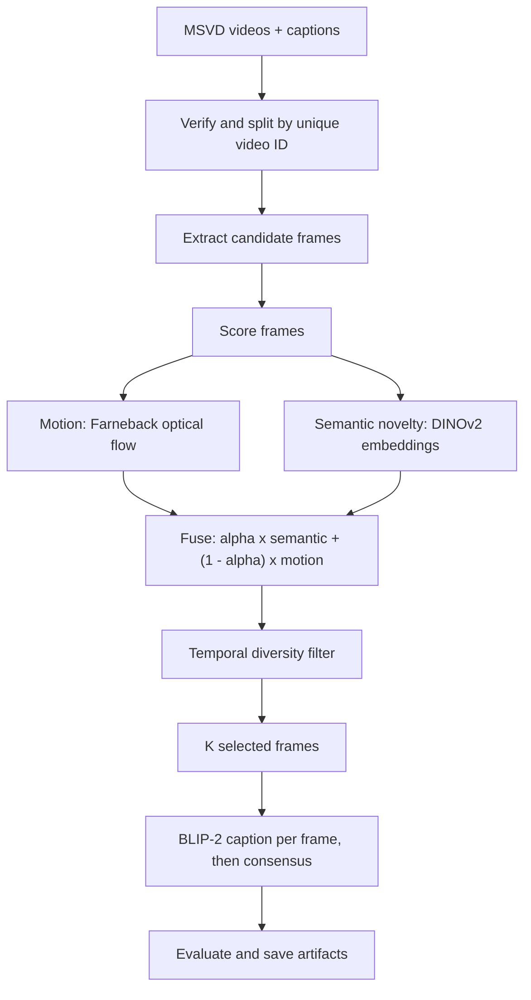

# Adaptive Video Captioning with Semantic-Motion Keyframe Selection

[](#getting-started)
[](#data)
[](./LICENSE)

Captioning a video with a vision-language model usually means processing many frames, which is expensive on modest hardware. This project selects a small set of informative keyframes first, then captions only those frames with BLIP-2. Frame selection combines motion cues, semantic novelty, and temporal diversity, and the project compares it against uniform and random sampling on the [MSVD](https://www.cs.utexas.edu/~ml/clamp/videoDescription/) corpus.

The main deliverable is a Colab-ready research notebook, [`notebooks/video_captioning_research.ipynb`](./notebooks/video_captioning_research.ipynb), which runs the full workflow. Reusable Python code and command-line scripts are provided for the same methods.

## Contents

- [Method](#method)
- [Status](#status)
- [Repository layout](#repository-layout)
- [Getting started](#getting-started)
- [Data](#data)
- [Usage](#usage)
- [Evaluation](#evaluation)
- [Configuration](#configuration)
- [Testing and CI](#testing-and-ci)
- [Known limitations](#known-limitations)
- [Contributing](#contributing)
- [License](#license)
- [Author](#author)

## Method



The notebook compares six selection methods at a fixed frame budget: `uniform`, `random`, `motion`, `semantic`, `semantic_motion`, and `semantic_motion_diverse` (the proposed method). Each selected frame is captioned at full resolution in one batched BLIP-2 call, and the video caption is the consensus of those per-frame captions.

Two design rules keep the comparison honest:

- **Split by video.** Train, validation, and test sets are disjoint on video ID.
- **Prespecified alpha.** The fusion weight alpha is fixed (default 0.5) before fine-tuning and shared by every arm. The validation alpha sweep is a sensitivity report only and never changes the test configuration.

## Status

- The pipeline, ablations, frame-budget study, and fine-tuning paths are implemented in the notebook.
- **No results are committed yet.** The notebook produces the metric tables when it is run on the MSVD data. Numbers will be added to this README once a frozen test run exists.
- The fine-tuned arms have not been scored on the test split yet. The fine-tuning code writes validation-selected checkpoints, and the test comparison is wired up to use them.
- Open methodology and reproducibility items are tracked in [`notebooks/TODO.md`](./notebooks/TODO.md).

## Repository layout

```text
.
├── notebooks/
│   ├── video_captioning_research.ipynb     # main research workflow (Colab)
│   └── TODO.md                             # notebook review items
├── scripts/                                # command-line entry points
│   ├── select_keyframes.py                 # select keyframes for one video
│   ├── inference.py                        # caption one video (optionally a fine-tuned checkpoint)
│   ├── train.py                            # LoRA fine-tuning
│   ├── evaluate.py                         # score a generated-caption CSV
│   └── build_notebook.py                   # regenerates the notebook from source cells
├── src/video_captioning/                   # reusable library
│   ├── data/                               # caption normalization, video indexing, splits
│   ├── keyframes/                          # motion, semantic, and selection pipeline
│   ├── models/                             # BLIP-2 captioner
│   ├── training/                           # fine-tuning
│   ├── evaluation/                         # BLEU, METEOR, ROUGE-L, CIDEr
│   └── utils/                              # configuration and seeding
├── configs/                                # YAML settings for the scripts
├── tests/                                  # unit tests
├── research/                               # methodology, data dictionary, experiment notes
├── coursework/                             # separate course lab, not part of the research pipeline
├── results/                                # tracked placeholder folders; generated outputs are git-ignored
├── .github/workflows/                      # CI: lint and tests
├── requirements.txt
└── pyproject.toml
```

## Getting started

### On Google Colab (recommended)

1. Open [`notebooks/video_captioning_research.ipynb`](./notebooks/video_captioning_research.ipynb) in Colab with a GPU runtime (a T4 is enough).
2. In Section 0, set the paths if you are not using the defaults (see [Configuration](#configuration)).
3. Run the cells in order. The environment cell reports any packages that are missing.
4. Keep the fine-tuning and ablation flags off until the smoke test passes.

### Locally

Requires Python 3.10–3.12 and a CUDA-capable PyTorch build for GPU work.

```bash
python -m venv .venv
source .venv/bin/activate
pip install -e ".[dev,analysis]"
```

Install the matching CUDA build of PyTorch first if your machine needs one. `requirements.txt` lists the pinned versions.

## Data

The project uses the [MSVD (Microsoft Research Video Description) corpus](https://www.cs.utexas.edu/~ml/clamp/videoDescription/).

**Videos.** The notebook downloads the official video archive (`YouTubeClips.tar`, about 1.7 GiB) when it is not already present. It checks the MD5 checksum and then extracts and verifies all 1,970 clips. Downloads resume if interrupted.

**Captions.** The notebook reads the official annotation file, `MSR Video Description Corpus.csv`, from `<DATA_ROOT>/data/extracted/annotations/`. This file is **not downloaded automatically** yet; place it there yourself. Only English captions are used. The notebook keeps the 80,838 English caption rows that match an extracted video.

The command-line scripts use a simpler layout set in YAML:

```text
data/msvd/
├── YouTubeClips/        # video files
└── captions.csv         # caption records (video_id, caption)
```

Do not commit datasets, raw videos, or extracted frames. The `.gitignore` excludes `/data/` and the common video formats.

Caption schemas, video ID rules, and split logic are documented in [`research/data-dictionary.md`](./research/data-dictionary.md).

## Usage

### Notebook

The notebook is the reference implementation of the experiment. Its flags in Section 0 control what runs:

| Flag | Default | Effect |
|---|---|---|
| `USE_LORA` | `True` | LoRA adapters for fine-tuning |
| `USE_4BIT` | `False` | 4-bit loading (needs `bitsandbytes`) |
| `RUN_FINETUNING` | `False` | fine-tune the two training arms |
| `RUN_TEST_ABLATIONS` | `False` | run the test-set ablation |
| `RUN_FRAME_BUDGET_STUDY` | `False` | run the frame-count study |

### Command line

```bash
# Select keyframes for one video
python scripts/select_keyframes.py --video path/to/video.avi --config configs/baseline.yaml

# Caption one video (optionally with a local fine-tuned checkpoint)
python scripts/inference.py --video path/to/video.avi --config configs/baseline.yaml

# LoRA fine-tuning; downloads BLIP-2 and DINOv2 weights and needs a local MSVD copy
python scripts/train.py --config configs/training.yaml

# Score a generated-caption CSV with video_id and caption columns
python scripts/evaluate.py --predictions outputs/generated_captions.csv --config configs/baseline.yaml
```

The scripts download model weights on first use.

## Evaluation

The evaluator reports BLEU-1 to BLEU-4, METEOR, ROUGE-L, and CIDEr. CIDEr is computed when `pycocoevalcap` is installed (it is in the `analysis` extra).

Metric caveats:

- Every metric scores captions and references after the internal protocol `lowercase_ascii_alphanumeric_v1` (lowercase, keep only ASCII letters and digits). ROUGE-L is unstemmed. This is **not PTB/coco-caption tokenization**, so scores are not directly comparable with published coco-caption or MSVD numbers.
- CIDEr computes IDF weights from the references of the set being scored. Compare CIDEr only across methods scored on the same video IDs. The notebook enforces this with a shared paired-ID set.
- METEOR needs the NLTK `wordnet` corpus. It downloads on first use. Offline, run `python -m nltk.downloader wordnet` beforehand.

## Configuration

Settings live in [`configs/`](./configs):

- `baseline.yaml`: dataset paths, seed, frame budget, selection alpha, split ratios, and model name.
- `training.yaml`: fine-tuning batch size, accumulation, learning rate, epochs, LoRA, and 4-bit loading. It inherits `baseline.yaml`.

Notebook Section 0 reads these environment variables, all optional:

| Variable | Default |
|---|---|
| `MSVD_DATA_ROOT` | `/content/msvd` |
| `MSVD_VIDEO_DIR` | `YouTubeClips` |
| `MSVD_CAPTION_FILE` | `captions.csv` |
| `OUTPUT_DIR` | `/content/video_captioning_outputs` |

The command-line scripts read YAML only and do not use these variables.

## Testing and CI

```bash
pytest
```

The unit tests cover caption normalization, video-level splitting, keyframe selection and scoring, evaluation-pair handling, and the model wrapper. Some tests need `torch`, `cv2`, or `nltk` and are skipped when those are missing.

GitHub Actions runs flake8 and pytest on Python 3.10, 3.11, and 3.12 for every push and pull request to `main`.

## Known limitations

- **No committed results yet.** Metric values depend on running the notebook on MSVD.
- **Fine-tuned test results are pending.** The fine-tuned arms are trained and their checkpoints are selected on validation loss, but they have not been evaluated on the test split.
- **Split granularity.** The split is by clip ID. Clips cut from the same YouTube video can share scenes, so a near-duplicate could fall in a different split. A split by YouTube ID is planned (see `notebooks/TODO.md`).
- **Metric tokenization** (`lowercase_ascii_alphanumeric_v1`) differs from published MSVD evaluation (see [Evaluation](#evaluation)).
- **Package pins.** The notebook records the installed versions but does not yet enforce the pins in `requirements.txt`. The most recent recorded Colab run used newer versions of some packages.
- **Colab defaults.** Section 0 defaults to `/content/...` paths and the archive search also checks `/content`. Outside Colab, set the environment variables in [Configuration](#configuration).
- **Annotation CSV** must be placed manually (see [Data](#data)).
- **Scope.** This is a research codebase. It has no serving API or deployment target.

## Contributing

Changes should keep to these rules:

- split by unique video ID, never by caption row
- keep choices made on validation data separate from test-set reporting
- keep configuration in one place
- write outputs to deterministic artifact paths
- do not hardcode a local path

Edit the notebook through `scripts/build_notebook.py`, then regenerate it. Do not hand-edit the `.ipynb`.

## 📚 Documentation

Comprehensive documentation for this project is available on [Hashnode](https://hashnode.com/@Shashwat56).

> At present, this README serves as the primary source of documentation.

## 📜 License

This project is distributed under the MIT License.  
For detailed licensing information, please refer to the [LICENSE](./LICENSE) file included in this repository.

## 📩 Contact  
## Shashwat

**Machine Learning Engineer | Scalable AI Systems**

🔹 **ML systems:** (CV, NLP) + data pipelines<br>
🔹 **End-to-end:** training → deployment<br>
🔹 **Backend & Cloud:** Python, Flask, Node.js, Docker, AWS<br>
🔹 **Projects:** Traffic AI, Video Summarizer, AI Assistants<br>

---

## 🚀 Open Source | Tech Innovation  
Building robust applications and leveraging cloud technologies for high-performance solutions.

---

### 📌 Find me here:  
[](https://github.com/Shashwat-19)  [](https://www.linkedin.com/in/shashwatk1956/)  [](mailto:shashwat1956@gmail.com)  [](https://hashnode.com/@Shashwat56)
[](https://www.hackerrank.com/profile/shashwat1956)

> Feel free to connect for tech collaborations, open-source contributions, or brainstorming innovative solutions!

