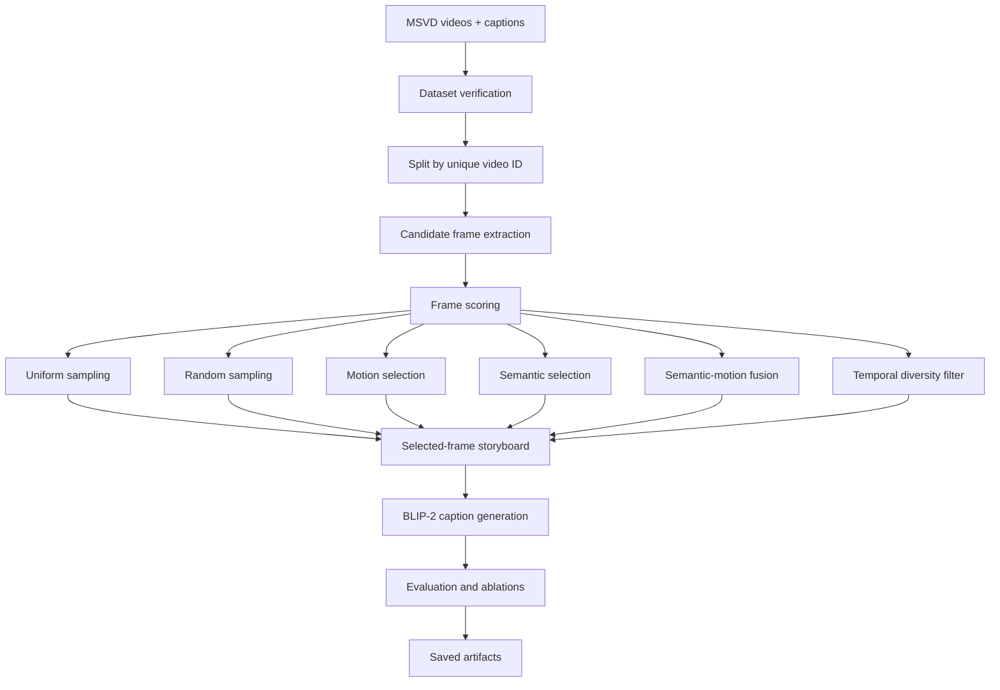

# Adaptive Video Captioning with Semantic-Motion Keyframe Selection

Reduces the cost of video captioning on MSVD by selecting informative keyframes before running BLIP-2, instead of processing every frame.

This repository centers on a Colab-ready research notebook:

- [`notebooks/video_captioning_research-4.ipynb`](./notebooks/video_captioning_research-4.ipynb)

It implements video-level splits, candidate frame extraction, motion and semantic scoring, adaptive semantic-motion fusion, temporal diversity filtering, BLIP-2 inference, T4-conscious fine-tuning, evaluation, ablations, and artifact saving.

[](./notebooks/video_captioning_research-4.ipynb)
[](#quickstart)
[](#data)
[](#training)

---

## Table of Contents

- [Problem & Approach](#problem--approach)
- [Architecture](#architecture)
- [Results](#results)
- [Quickstart](#quickstart)
- [Project Structure](#project-structure)
- [Data](#data)
- [Training](#training)
- [Evaluation](#evaluation)
- [Inference / Serving](#inference--serving)
- [Deployment](#deployment)
- [Configuration](#configuration)
- [Testing](#testing)
- [Monitoring & Drift](#monitoring--drift)
- [Known Limitations](#known-limitations)
- [Roadmap](#roadmap)
- [Contributing](#contributing)
- [Citation](#citation)
- [License](#license)

---

## Problem & Approach

Video captioning models often become expensive when they process long clips frame by frame, especially on constrained hardware like a single NVIDIA T4 GPU. The project addresses this by selecting a small set of representative keyframes from each video and captioning those frames with a pretrained vision-language model.

The core approach combines motion cues, semantic novelty, and temporal diversity so the selected frames cover what changes in the video without wasting compute on near-duplicates. The notebook compares uniform sampling, random sampling, motion-only selection, semantic-only selection, fused selection, and diversity filtering.

Non-goals:

- It does not attempt end-to-end dense video understanding.
- It does not require multi-GPU training.
- It does not depend on A100/H100-class hardware.
- It does not hardcode a single MSVD directory layout.

## Architecture



| Component | Purpose |
|---|---|
| Notebook | Main research workflow and experiment runner |
| OpenCV | Video metadata, frame extraction, motion features |
| BLIP-2 | Vision-language caption generation |
| LoRA / mixed precision | T4-friendly fine-tuning |
| Pandas / NumPy | Split logic, scoring tables, result tables |
| Matplotlib / Seaborn | EDA and result visualizations |

## Results

The notebook is structured to produce comparable results across baselines and the proposed method, but the final metric values depend on the dataset path and on whether you run the optional training/evaluation cells.

Use the generated tables in `results/metrics/` and the consolidated outputs in `results/metrics.csv` and `results/final_results.csv` as the source of truth after execution.

| Metric | Baseline | This Model | Delta | Notes |
|---|---:|---:|---:|---|
| BLEU-1 | run notebook | run notebook | run notebook | reported per split/method |
| BLEU-4 | run notebook | run notebook | run notebook | optional CIDEr if available |
| METEOR | run notebook | run notebook | run notebook | caption similarity metric |
| ROUGE-L | run notebook | run notebook | run notebook | sequence overlap metric |
| CIDEr | run notebook | run notebook | run notebook | computed when dependency exists |

## Quickstart

For a local environment, install the package from the repository root:

```bash
python -m venv .venv
source .venv/bin/activate
pip install -e ".[dev,analysis]"
```

On Google Colab, clone the repository, change into it, and run the notebook's environment cell. Colab already provides PyTorch; install only any packages that the notebook reports as missing.

1. Open [`notebooks/video_captioning_research-4.ipynb`](./notebooks/video_captioning_research-4.ipynb) in Google Colab.
2. Set the dataset paths in Section 0.
3. If needed, mount Google Drive in the optional drive cell.
4. Run the environment, dataset verification, splitting, and preprocessing cells.
5. Keep the heavier fine-tuning and ablation flags disabled until you are ready to run them.

Minimal run sequence in the notebook:

```text
0. Research Configuration
1. Environment and GPU Setup
2. Dataset Loading and Verification
3. Exploratory Data Analysis
4. Dataset Splitting
5. Video Preprocessing
6. Candidate Frame Extraction
...
25. Conclusions and Research Interpretation
```

## Project Structure

```text
.
├── README.md
├── LICENSE                  # MIT
├── .flake8                  # flake8 config used by CI lint
├── .gitignore               # Keeps datasets, checkpoints, and generated outputs out of Git
├── .github/workflows/       # CI: flake8, pytest, and import checks
├── configs/                 # Reproducible baseline and training settings
├── coursework/              # Separate course lab (Lab 8); not part of the research pipeline
├── notebooks/               # Colab-first research workflow
│   └── video_captioning_research-4.ipynb
├── research/                # Methodology, experiment log, and READ-format.md (a generic README template)
├── results/                 # Empty tracked artifact locations; outputs are ignored
├── scripts/                 # CLI entry points and notebook generator
├── src/video_captioning/    # Reusable data, keyframe, model, training, and metric code
├── tests/                   # Deterministic unit tests
├── pyproject.toml
└── requirements.txt
```

The notebook writes outputs into its configured `OUTPUT_DIR`. The reusable scripts write to the `output_dir` specified in YAML, typically under:

```text
results/
checkpoints/
configs/
cache/
```

## Data

The workflow is built around the MSVD (Microsoft Research Video Description) dataset corpus.

### Dataset Acquisition (Kaggle)

The MSVD dataset can be obtained from Kaggle using the `kagglehub` package.

- **Kaggle Dataset Identifier**: `vtrnanh/msvd-dataset-corpus`

To download the dataset programmatically:

```python
import kagglehub

path = kagglehub.dataset_download("vtrnanh/msvd-dataset-corpus")
print("Path to dataset files:", path)
```

> **Important**: Do **NOT** commit the downloaded dataset, raw video files, or extracted frames into Git. The repository's `.gitignore` excludes `/data/`, `/datasets/`, and raw video formats (`*.avi`, `*.mp4`, etc.).

### Dataset Layout & Configuration

The supported caption schemas, ID rules, video matching, and split logic are described in [`research/data-dictionary.md`](./research/data-dictionary.md).

Once downloaded, point the configuration at the dataset path. In the notebook, set `DATA_ROOT` in Section 0 (or the `MSVD_DATA_ROOT` environment variable). For the CLI scripts, set `data_root` in the YAML config; the scripts do not read environment variables. The expected directory structure is:

```text
msvd/
├── YouTubeClips/
│   ├── video1.avi
│   ├── video2.avi
│   └── ...
└── captions.csv
```

- **Split strategy**: unique video ID (disjoint train, validation, and test sets), not caption-row randomization
- **Supported caption schemas**: flexible CSV, TSV, and JSON parsing
- **Dataset checks**: video count, caption count, missing file count, sample records
- **Configured locations**: in the notebook, `DATA_ROOT` (or `MSVD_DATA_ROOT`), `VIDEO_DIR` (or `MSVD_VIDEO_DIR`), `CAPTION_FILE` (or `MSVD_CAPTION_FILE`), and `OUTPUT_DIR` (or the `OUTPUT_DIR` environment variable); in the YAML configs used by `scripts/`, `data_root`, `video_dir`, `caption_file`, and `output_dir`


Example caption records:

| video_id | caption |
|---|---|
| `video1` | `a man is playing guitar on stage` |
| `video1` | `the musician performs for the crowd` |
| `video2` | `a dog runs across the grass` |

The notebook saves:

- `train_video_ids.csv`
- `val_video_ids.csv`
- `test_video_ids.csv`
- complete split metadata in `configs/split_metadata.json`

## Training

The notebook includes T4-conscious fine-tuning paths. Each fine-tuning arm (`uniform` and `semantic_motion_diverse`) keeps the epoch with the lowest validation loss and records it in `best_checkpoint.json`, written only after the run finishes. A run that is interrupted, or whose validation loss is not finite, leaves no pointer. `freeze_test_configuration` stores each arm's checkpoint path and a SHA-256 hash of its files with the frozen configuration. When `RUN_TEST_ABLATIONS` is on, `run_ablation` includes the fine-tuned arms only if the frozen configuration names checkpoints for them; it then scores them alongside the zero-shot methods on one paired set of test videos. It refuses to start if either arm is missing from the freeze, or if a frozen checkpoint is gone or its files changed. If the freeze was recorded before training, the ablation runs zero-shot only. The alpha sweep uses the zero-shot base model by default, so the frozen alpha is tuned on the base model; pass `checkpoint=` to `plot_alpha_sensitivity` to tune it on a fine-tuned checkpoint instead. Two limits are still open (see `notebooks/TODO.md`): the arms train with whatever `ALPHA` is set when Section 15 runs, which can differ from the frozen alpha, and the freeze check does not cover every generation setting (for example the prompt and `num_beams`). The fine-tuned arms' test captions have not been generated yet.

- mixed precision where available
- small batch sizes
- gradient accumulation
- optional LoRA
- optional 4-bit loading when supported
- explicit GPU memory cleanup

The training sections are designed to be opt-in through configuration flags so that you can run a fast smoke test first and only enable longer experiments when needed.

The equivalent command-line entry point uses the same implemented methodology:

```bash
python scripts/train.py --config configs/training.yaml
```

It downloads the configured BLIP-2 and DINOv2 checkpoints and requires a valid local MSVD path, so it is intentionally not a lightweight smoke test.

## Evaluation

The notebook supports automatic caption evaluation with:

- BLEU-1 to BLEU-4
- METEOR
- ROUGE-L
- CIDEr when the dependency is available (`pycocoevalcap`, included in the `analysis` extra and `requirements.txt`)

Metric caveat: BLEU and METEOR split captions on whitespace with no lowercasing or PTB tokenization, and CIDEr receives the raw caption strings, so scores are not directly comparable to published coco-caption or MSVD results. CIDEr computes its IDF weights from the references of the set being scored, so compare CIDEr only between methods evaluated on the same video IDs.

It also produces:

- ablation tables
- frame-budget studies
- efficiency comparisons
- qualitative examples
- final summary tables

To score a generated-caption CSV with `video_id` and `caption` columns:

```bash
python scripts/evaluate.py --predictions outputs/generated_captions.csv \
  --config configs/baseline.yaml
```

METEOR needs the NLTK `wordnet` corpus. `evaluate_captions` downloads it on first use when it is missing; on a machine without internet access, run `python -m nltk.downloader wordnet` beforehand.

## Inference / Serving

This repository is not a serving project. The notebook is optimized for offline research inference and experiment comparison rather than a deployed API.

For inference inside the notebook, the workflow:

1. selects frames
2. composes them for BLIP-2
3. generates captions
4. writes outputs to the artifact directories

The same local-video workflow is available as a CLI (and downloads model weights on first use):

```bash
python scripts/select_keyframes.py --video path/to/video.avi
python scripts/inference.py --video path/to/video.avi
```

## Deployment

There is no production deployment target in this repository.

The intended runtime is:

- Google Colab
- optionally Kaggle
- optionally a local Python environment with GPU support

## Configuration

Baseline and training settings are stored in [`configs/`](./configs). The notebook retains an equivalent Section 0 configuration block for a self-contained Colab workflow.

Key values (notebook Section 0 names; the YAML configs use the lowercase equivalents, such as `data_root`, except for the notebook-only `RUN_*` flags):

- `DATA_ROOT`
- `VIDEO_DIR`
- `CAPTION_FILE`
- `OUTPUT_DIR`
- `SEED`
- `NUM_CANDIDATE_FRAMES`
- `NUM_SELECTED_FRAMES`
- `ALPHA`
- `RUN_FINETUNING`
- `RUN_TEST_ABLATIONS`
- `RUN_FRAME_BUDGET_STUDY`

The notebook also prints:

- GPU name
- GPU memory
- CUDA availability
- PyTorch version

## Testing

The repository includes lightweight unit tests for caption normalization, video-level splitting, keyframe selection, evaluation-pair handling, and storyboard composition:

```bash
pytest
```

The notebook additionally performs practical checks:

- dataset existence and schema checks
- GPU capability inspection
- unique-video split verification
- video readability and metadata extraction
- artifact-path creation

## Monitoring & Drift

This is a research notebook, not an always-on service, so runtime monitoring is limited to saved logs and artifact outputs.

Useful outputs include:

- frame-selection score CSVs
- generated caption tables
- evaluation summaries
- efficiency tables
- qualitative result images

If you extend this into a deployed system later, the most relevant drift signals would be changes in caption length, token distribution, video duration distribution, and the quality of selected keyframes.

## Known Limitations

- The notebook expects the user to point it at a valid MSVD layout.
- The notebook's path defaults are Colab paths: `DATA_ROOT` defaults to `/content/msvd` and `OUTPUT_DIR` to `/content/video_captioning_outputs` (override with `MSVD_DATA_ROOT` and `OUTPUT_DIR`). The optional Drive cell mounts at `/content/drive`. The committed notebook also uses fixed `/content` paths that the variables do not change: Section 2 searches `/content` for the video archive, Section 2b searches fixed `/content/...` fallback locations, and Section 23 sets `OUT` to `/content/video_captioning_outputs` directly. Outside Colab, set the variables for Section 0 and edit those cells' paths, including the Section 23 `OUT` line.
- Full fine-tuning can be slow on a T4 and is intentionally disabled by default.
- CIDEr depends on optional evaluation packages.
- The repository does not include the MSVD dataset itself.
- There is no separate inference API or deployment service.

## Roadmap

- add a small end-to-end smoke test notebook
- record a representative benchmark run with real metrics

## Contributing

If you extend the notebook, keep the following constraints intact:

- split by unique video ID
- preserve the Colab/T4 memory budget
- keep configuration centralized
- save outputs in deterministic artifact locations
- avoid hardcoding a single local path

## License

This project is distributed under the MIT License.  
For detailed licensing information, please refer to the [LICENSE](./LICENSE) file included in this repository.

## Contact
## Shashwat

**Machine Learning Engineer | Scalable AI Systems**

🔹 **ML systems:** (CV, NLP) + data pipelines<br>
🔹 **End-to-end:** training → deployment<br>
🔹 **Backend & Cloud:** Python, Flask, Node.js, Docker, AWS<br>
🔹 **Projects:** Traffic AI, Video Summarizer, AI Assistants<br>

---

## Open Source | Tech Innovation  
Building robust applications and leveraging cloud technologies for high-performance solutions.

---

### Find me here:  
[](https://github.com/Shashwat-19)  [](https://www.linkedin.com/in/shashwatk1956/)  [](mailto:shashwat1956@gmail.com)  [](https://hashnode.com/@Shashwat56)
[](https://www.hackerrank.com/profile/shashwat1956)

> Feel free to connect for tech collaborations, open-source contributions, or brainstorming innovative solutions!

